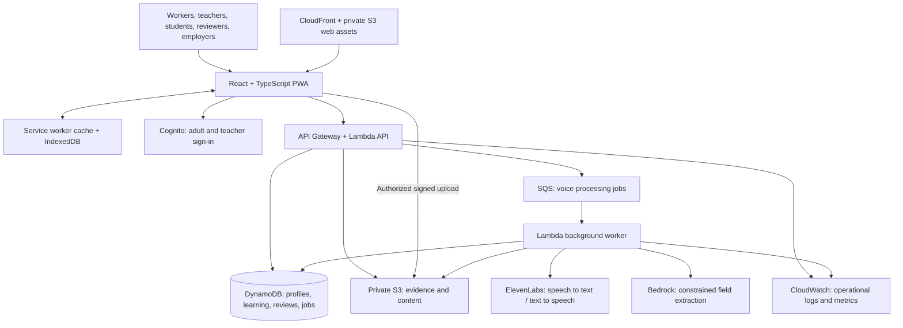

# Hunar — Final Hackathon Architecture and Prototype Plan

- **Version:** 1.0 · **Prepared:** 24 November 2026
- **Track:** UnlockED — Unlocking Educational Potential, Empowering Futures
- **Product line:** Learn locally. Prove your skills. Find work nearby.
- **Status:** Design reference. See README.md for the prototype implementation and setup.

## 1. Final product decision

Build **one mobile-first progressive web application (PWA)** with three connected capabilities:

1. **Hunar Learn:** downloadable, regional-language learning with local adaptation and progress sync. It has separate school and adult vocational content.
2. **Hunar Proof:** practical skill demonstrations, structured peer/trainer review, and shareable micro-credentials for adult vocational learners and workers.
3. **Hunar Nearby:** a voice-assisted local job board for informal and semi-skilled adult workers and local employers.

The flagship adult journey is **learn → demonstrate → receive a review → share evidence → discover nearby work**. The school journey is **download → practise offline → receive appropriate next questions → sync → teacher review**.

These journeys share infrastructure, not age-inappropriate workflows. Student profiles do not enter the worker directory, employer search, or job matching.

**Primary demonstration:** an adult plumbing assistant demonstrates a simple task on a safe, disconnected practice rig, receives a trainer's review, and finds a local assistant opening. A short classroom demonstration separately proves that rural-school learning works offline.

## 2. What the new brief changes

The supplied screenshot describes three specific problem areas. It does not establish whether teams must address all three or may choose one; this plan combines them because that is the team's chosen direction. Do not claim that covering all three is an organizer requirement.

| New problem-statement detail | Final architecture response | Change from the earlier concept |
|---|---|---|
| Localized vocational skill verification for informal workers | Short practical videos, structured review, evidence-backed public profile | Replace retail conversation as the main assessment with an observable vocational task |
| Short video demonstrations or peer verification | Private evidence uploads and an actual reviewer workflow | AI feedback alone cannot issue a reviewed credential |
| Low-bandwidth adaptive learning for rural schools | A separate school mode with offline questions, regional-language audio, and teacher progress view | Vocational lessons alone do not satisfy the rural-school audience |
| Hyper-local matching for informal and semi-skilled workers | Locality-based discovery, transparent wage units, availability, voice-assisted posting/search | Replace generic sample office roles with nearby trade/helper openings |
| Simple web UI or messaging channels | Installable web app with large controls and voice/text alternatives | Messaging integrations are optional future work |

**Retained from the original three ideas:** skill passports, short lessons, shared-device access, business participation, and opportunity discovery.

**Changed:** LocalLab becomes the employer/job side of Hunar Nearby. A full project marketplace is deferred; it would compete with the newly specified verification and job-board work.

## 3. Assumptions and scope boundaries

- Planning assumption: a team of 3–4 people, a limited preparation window, and the organizer's stated 24-hour hack day. The schedule below is a sequencing estimate, not a delivery guarantee.
- Initial languages: Hindi and English, subject to testing the selected voice model and team-reviewed translations.
- Geography: one configured pilot district with a small set of named localities and neighboring-locality relationships.
- Initial trade: plumbing assistant; one safely observable task and one correction/retry path.
- School content: one teacher-reviewed upper-primary numeracy unit, with questions at three difficulty levels. Curriculum alignment must be checked before making a school-curriculum claim.
- Adult work mode is restricted to adults in this prototype. School profiles are provisioned by a teacher account and remain separate.
- The existing screenshots describe an early prototype advantage, a 24-hour hack-day build window, and optional ElevenLabs/AWS sponsor awards. They do not supply a complete scoring rubric or sponsor eligibility conditions.
- Seeded people, jobs, reviews, and employer identities must be visibly marked as demonstration data.

## 4. Prototype scope to commit to

### Must work by the final demonstration

| Capability | Concrete deliverable |
|---|---|
| Adult onboarding | Language, trade, coarse locality, availability, and consent settings |
| School mode | Teacher account, two pseudonymous student profiles, one downloadable numeracy pack |
| Offline adaptation | Locally choose easier/harder questions based on recent answers; store attempts and sync later |
| Practical assessment | Task instructions, 30–60 second video upload, and submission status |
| Reviewer flow | Trainer/peer views evidence, records rubric findings, requests changes or approves |
| Skill passport | Credential detail with task, issuer, review type, date, evidence summary, and revocation state |
| Nearby jobs | Five seeded listings with trade, locality, schedule, wage/unit, and application status |
| Voice accessibility | One functioning voice search or employer-posting flow; text remains available |
| Employer flow | Create/confirm a job and review an application shared by a worker |
| Resilience | Offline indicator, queued learning progress, retry state, and no duplicate progress after retry |

### Stretch only after the complete flow works

- Voice notes accompanying practical videos.
- Second trade or second school unit.
- Public lesson audio pre-generated with ElevenLabs.
- Multiple independent reviewers and reviewer calibration.
- Resumable multipart video upload.
- More detailed location search and maps.

### Deferred

Payments, escrow, automatic hiring, government certification, face recognition, voice cloning, blockchain credentials, live video interviews, WhatsApp integration, an unrestricted AI tutor, automatic video-based trade certification, and a full gig/project marketplace.

## 5. Users, permissions, and screens

| Actor | Can do | Cannot do |
|---|---|---|
| Adult worker | Learn, submit evidence, inspect reviews, share selected credentials, search/apply for work | Approve their own submission or edit an issued credential |
| Reviewer | Review assigned evidence against a fixed rubric | Review their own work, access all private worker media, or invent formal accreditation |
| Employer | Publish jobs, receive applications, view evidence the applicant shares | Browse private student data or unshared worker videos |
| Teacher | Provision class aliases, assign packs, see their class's progress | Publish student progress into worker passports |
| Student profile | Practise assigned material and see learning feedback | Access jobs, employer messaging, or a public worker profile |
| Administrator | Manage task templates, reviewer assignments, content, and revocations | Silently rewrite review history |

**Learner navigation:** Home · Learn · Prove · Nearby · Passport. School mode shows only Learn and Progress. Teacher/reviewer/employer dashboards use the same application with server-enforced role permissions.

**Main screens:** language/mode selection; adult profile or class selection; learning library; offline lesson player; practical-task instructions; evidence submission; review queue; review detail; passport/share controls; nearby listings; job detail/apply; employer posting/applicants; teacher progress.

Use large tap targets, text alongside audio, readable contrast, explicit loading/error states, and clear Pending/Uploaded/Reviewed labels. A voice-only interface is not accessible to everyone, so every critical task also has a text or touch path.

## 6. System architecture

Use a **modular backend in one repository**, with one HTTP API and one background worker. Modules are logical code boundaries, not separately deployed microservices.



### Selected stack

| Layer | Choice | Purpose |
|---|---|---|
| Frontend | React, Vite, TypeScript, Tailwind CSS | Mobile web UI with one language across frontend/backend |
| Offline | Service worker/Workbox, IndexedDB through Dexie | Cache public packs and queue pseudonymous practice events |
| Hosting | S3 and CloudFront | HTTPS static delivery; private bucket behind the distribution |
| Identity | Cognito user pool | Adult/teacher accounts and authenticated sessions |
| API | API Gateway HTTP API + TypeScript Lambda | Authorization and business rules |
| Data | DynamoDB | Profiles, review records, learning events, job and application access patterns |
| Media | Private S3 with short-lived signed access | Evidence video and generated audio |
| Background work | SQS + Lambda worker + dead-letter queue | Voice processing with visible completion/failure states |
| AI | ElevenLabs STT/TTS; a tested Bedrock model | Spoken input/output and constrained extraction |
| Validation | Shared schemas, for example Zod | Validate API inputs and model outputs |
| Infrastructure | AWS CDK in TypeScript | Reproducible setup and teardown |

Pin package versions during implementation. Before building dependent features, verify AWS region/model access, ElevenLabs account capabilities, credentials, and quotas. No specific provider price, language quality, or latency is assumed.

ElevenLabs documents both [speech-to-text](https://elevenlabs.io/docs/overview/capabilities/speech-to-text) and [text-to-speech](https://elevenlabs.io/docs/overview/capabilities/text-to-speech). Those capabilities support this design, but language/model choices still need a real account smoke test. AWS's [Bedrock Converse documentation](https://docs.aws.amazon.com/bedrock/latest/userguide/conversation-inference.html) is the implementation reference for model conversation calls.

## 7. Module A — Hunar Learn

### Two content collections, one learning engine

**School collection:** numeracy questions, short regional-language explanations, pictures, optional downloaded audio, and teacher progress.

**Adult collection:** task preparation, measurement practice, identification of tools/materials, and reviewer-authored remediation mapped to vocational rubric criteria.

Content packs contain a manifest, version, language, audience, prerequisites, lesson files, answer keys for practice, question difficulty, explanations, and asset hashes. Display download size before fetching. A pack is marked available offline only after all required assets are stored and verified.

### Simple, explainable adaptation

Use a deterministic local engine for the MVP:

1. Start at a teacher-assigned or default level.
2. After two consecutive correct answers on different questions at that level, offer the next difficulty.
3. After an incorrect answer, show an explanation and offer an easier or scaffolded question.
4. Keep difficulty within the pack's available levels and avoid repeating the same question immediately.
5. Store each attempt with the question version and adaptation-rule version.

These are prototype teaching rules, not a validated measure of mastery. Report “practice progress” and topic-specific answers, not an invented intelligence or employability score.

### Offline and shared-phone behavior

| Function | Offline? | Boundary |
|---|---|---|
| Previously downloaded lessons and audio | Yes | Browser storage may be evicted; show actual availability |
| Practice exercises and adaptive next question | Yes | Local rules and content only |
| New content download | No | Requires connectivity |
| Practice progress capture | Yes | Queue immutable events until authorized sync |
| New AI-generated explanation or voice transcription | No | Provide prepared content/text fallback |
| Evidence upload and reviewer decisions | No in MVP | New uploads need connectivity |
| Job discovery/applications | Online in MVP | Do not present old listings as currently available |
| Credential issuance/revocation | No | Server-authorized operations only |

Cache public learning content. Keep student offline progress under generated aliases, with no phone numbers or real names in the local record. Alias selection or a local PIN is a convenience lock, **not strong authentication or a guarantee of secrecy on a shared device**. Show a clear-device option and explain this boundary to the teacher.

Keep adult private evidence, credentials, contact details, and authenticated API responses out of the service worker cache. Sensitive adult actions require online authentication. On adult account switch, clear in-memory data and private application caches.

### Sync protocol

Each learning event includes `eventId`, `profileId`, `deviceId`, `packVersion`, `questionId`, `answer`, and `clientCreatedAt`. Server records `receivedAt` separately; it does not trust device time for official chronology.

1. Save the event locally first.
2. Sync on app open, regained connectivity, and a visible **Sync now** action. Do not depend solely on background browser execution.
3. Server authorizes that the teacher/device session can write for the profile.
4. Insert each event conditionally by its unique ID; duplicates are acknowledged without being counted again.
5. Delete local queued events only after acknowledgement.
6. Recompute server progress from accepted events; do not use last-write-wins for the whole progress record.

Expired authentication leaves events pending until sign-in. An old pack version remains attached to its attempts; content updates do not reinterpret earlier answers. Offline practice events are self-reported practice, never proof of vocational competence.

## 8. Module B — Hunar Proof

### Initial practical task

Use a trainer-approved task such as identifying components and assembling a connection on a **disconnected, low-pressure plumbing training rig**. The reviewer defines the permitted equipment, observation requirements, and pass criteria before filming. Avoid live electrical work, mains pressure, or a task the team is not qualified to supervise.

The assessment is about the demonstrated task. A short clip cannot establish complete professional competence or identity.

### Evidence and review flow

1. Worker opens a versioned task template and sees the rubric before starting.
2. Worker records/selects a short video. Target 30–60 seconds; enforce a configured upload cap, initially 20 MB. Low-resolution recording is best effort, not a promise of universal in-browser compression.
3. API creates an evidence record and returns a restricted signed upload form.
4. Browser uploads directly to private S3. The API checks the expected object, actual size, and allowed media type before accepting submission.
5. A reviewer is assigned. The worker cannot select themselves as reviewer.
6. Reviewer views the video through temporary authorization and records a result for every criterion, with time references or notes.
7. Reviewer either requests another attempt or approves the specific task.
8. Server issues a credential referencing the immutable review and task version.

For the MVP, a failed upload retries the entire small file. Do not claim resumable uploading until multipart upload, part tracking, and recovery are actually implemented.

### Review evidence structure

Example rubric criteria: correct component identification; correct assembly sequence; visible completed connection; completion of the approved test step. A reviewer may select **not observable** when the clip does not show enough evidence. Missing evidence is not automatically a failed skill.

Store `criterionId`, `status`, `evidenceTimeRange`, `reviewerNote`, `rubricVersion`, and `reviewerId`. AI may transcribe an explanation or suggest a relevant lesson; it cannot silently approve criteria or issue a credential.

### Credential levels and integrity

- **Practice completed:** self-directed exercise; not reviewed.
- **Peer reviewed:** a named peer reviewed this task; not equivalent to accredited certification.
- **Trainer reviewed:** a reviewer with a recorded trainer role reviewed the task. Display how that role was established; demo identities stay labelled.

Public credential detail shows the task, skill tags, issuer, review type, review date, rubric version, and status. “Trainer reviewed” must not imply a government-recognized qualification.

Use a random share token/QR link resolved against the server. The worker selects which credentials and profile fields to share and can disable the link. Raw video and contact details remain private unless separately shared. Revoked credentials display a revoked state; history is retained rather than silently deleted. This provides an inspectable record without blockchain.

Submission states: `draft → uploading → submitted → in_review → changes_requested | approved`. A retry creates a new attempt linked to the previous one. Credentials have `active | revoked` status and are issued only from an approved review.

## 9. Module C — Hunar Nearby

### Employer posting

An employer speaks or types a request, for example: “I need a plumbing assistant in this locality tomorrow, eight hours, ₹700 for the day.”

The system extracts a draft with role, skills, locality, date, duration, wage amount, wage unit, number of openings, and contact preferences. Missing fields remain empty and must be supplied. The employer reviews and confirms the complete form before publication. AI does not invent wages or publish a listing automatically.

Jobs include explicit employer-verification status, payment terms, expiry, and a report action. Demo employers are not presented as verified real businesses. Real publication requires basic moderation and an accountable contact route.

### Worker discovery and matching

Workers can say or type “Show plumbing helper work near my locality.” Convert this into visible search filters and let the worker change them.

MVP retrieval uses the selected locality plus an explicit neighboring-locality list. This is **area matching**, not measured travel distance. Do not display kilometer distances without reliable coordinates and an actual distance calculation.

Rank results with transparent rules: overlap with required skill tags, same/neighboring locality, and stated availability. Display reasons such as “same locality,” “one reviewed skill matches,” and “availability not yet confirmed.” Missing information stays unknown. Never infer caste, gender, disability, age beyond work-mode eligibility, or personality from voice.

Use the same search filters for credentialed and uncredentialed workers. A credential can add evidence to an application; an unexplained AI score must not block access to all jobs. Employers make hiring decisions.

### Application flow

Worker opens job → sees wage/unit, schedule, requirements and freshness → chooses credentials/contact fields to share → confirms application → employer sees it in their dashboard.

No email, SMS, or messaging send is required for the demo. Re-check that a job is open when accepting the application. Use a unique worker/job key to prevent duplicate applications. State is `submitted → viewed → shortlisted | declined | withdrawn`; employer status changes remain visible to the worker.

## 10. Voice and AI processing

Use **push-to-talk**, short recordings, and an asynchronous job status for the first build. Continuous voice calls add complexity without proving the required job-board workflow.

```mermaid
sequenceDiagram
    participant User
    participant App as PWA
    participant API
    participant Worker as Voice worker
    participant Speech as ElevenLabs
    participant Model as Bedrock
    User->>App: Record short request
    App->>API: Create authorized voice job
    API-->>App: Job ID and upload authorization
    App->>API: Confirm audio upload
    API->>Worker: Queue job after validation
    Worker->>Speech: Transcribe audio
    Speech-->>Worker: Transcript
    Worker->>Model: Extract allowed fields into schema
    Model-->>Worker: Draft fields
    Worker->>Worker: Validate output; keep missing fields empty
    App->>API: Poll job status
    API-->>App: Transcript and editable draft
    User->>App: Correct and confirm
    App->>API: Submit ordinary validated form
```

Optional TTS reads the confirmed listing or explanation aloud. Pre-generated lesson audio can be downloaded with a pack; generating new speech remains online.

Treat transcripts, uploaded notes, job descriptions, and model output as untrusted data. The model gets no direct permission to publish jobs, grant credentials, change roles, or execute database commands. Validate against allowlisted fields and resolve skill/locality IDs through the application catalog.

Model or transcription failure returns the editable text form. An uncertain transcript is shown for correction. API keys stay server-side. Record provider request IDs and timing, but exclude raw audio, tokens, and personal transcripts from routine logs.

Voice jobs use `pending_upload → queued → processing → succeeded | failed`. Persist completed stages so a queue retry does not unnecessarily regenerate the entire result. Bound retries and surface permanent failure; do not leave an endless spinner.

## 11. Data model and access patterns

Use opaque IDs and server timestamps. Preserve content/rubric versions and the actor behind every review or status change. Define shared TypeScript schemas before splitting frontend/backend work.

| Entity | Minimum fields | Important relationship/rule |
|---|---|---|
| Account | Auth subject, enabled roles, status | Adult/teacher account linked to Cognito; roles are server-controlled |
| Profile | ID, account/teacher owner, audience, alias/display name, language, locality, trade tags | School and adult audience are separate immutable profile types |
| Pack | ID, version, audience, language, manifest key, checksums | Immutable content versions; public content, no embedded private learner data |
| Learning event | Event ID, profile, pack version, question, answer, device time, server time | Append-only; unique event ID per profile |
| Progress summary | Profile, topic, accepted attempts, current practice level | Rebuildable projection, not the source of evidence |
| Task template | ID/version, skill IDs, rubric, instructions, allowed media | A submission retains the exact version assessed |
| Submission | ID, worker, task version, object key, attempt number, prior attempt, status, assigned reviewer | Owner and reviewer access only |
| Review | ID, submission, reviewer, criterion findings, decision, timestamp | Final review immutable; corrections create new records |
| Credential | ID, worker, review, task/skill IDs, issuer type, status | One issue action per approved review; revocation is audited |
| Job | ID, employer, locality, skills, wage amount/unit, schedule, expiry, status, demo flag | No inferred missing wage or invented verification |
| Application | Job ID, worker ID, shared credential IDs, consent snapshot, status | Worker/job pair unique |
| Share link | Random token hash, owner, allowed fields/credential IDs, status, optional expiry | No direct public access to private evidence |
| Async job | ID, owner, purpose, input key, stage, result, attempts, expiry | Tenant-scoped polling; bounded processing |
| Audit event | ID, actor, action, target, server time | Required for reviews, issuance, revocation, and role changes |

### DynamoDB organization

Group records into six physical tables, with entity discriminators where multiple record types share a table:

1. **Identity:** accounts/profiles; index profiles by owning account or teacher.
2. **Content:** pack and task versions; query published content by audience/language.
3. **Learning:** partition by profile; event IDs and progress-summary records have distinct sort-key prefixes.
4. **Evidence:** submission, review, credential, and audit records; indexes support worker history and assigned-reviewer/status queue. Related IDs remain explicit.
5. **Marketplace:** jobs and applications; indexes support active jobs by locality, jobs by employer, and applications by worker/job.
6. **Operations:** voice jobs and share-link records; expiry fields for temporary data.

Never scan all jobs to answer a locality query. Query configured localities through the index, then filter small result sets for trade and availability. Every list endpoint is paginated. Because indexes may lag, re-read the authoritative record before approving, applying, or showing credential validity.

Use conditional writes for state transitions and duplicates. Review approval plus credential creation should be atomic, using a transaction and a deterministic credential ID derived from the review. Clients cannot set `approved`, `issuerType`, or credential status directly.

Store video/audio/files in S3, not DynamoDB. Keep S3 object keys opaque and partitioned by owner/submission. Use separate public-content and private-evidence prefixes or buckets with distinct permissions.

## 12. API contract

All authenticated routes derive the actor from the verified token. A client-supplied `profileId`, `workerId`, or `jobId` is a reference to authorize, not proof of ownership.

| Route | Purpose / authorization |
|---|---|
| `GET /me` | Current account, permitted profiles and roles |
| `POST /profiles` | Adult profile or teacher-owned school alias; server checks allowed audience |
| `GET /packs?audience=&language=` | Published learning catalog |
| `GET /packs/:id/versions/:version` | Immutable manifest and public asset references |
| `POST /learning/sync` | Authorized batch of immutable practice events; per-event acknowledgements |
| `GET /learning/profiles/:id/progress` | Owner/teacher progress summary |
| `GET /tasks/:id` | Published task instructions and rubric version |
| `POST /submissions` | Create worker-owned assessment attempt |
| `POST /submissions/:id/upload` | Restricted signed media upload authorization |
| `POST /submissions/:id/submit` | Validate stored object; move draft into review queue |
| `GET /reviews/queue` | Assigned-reviewer queue only |
| `POST /submissions/:id/reviews` | Assigned reviewer submits criterion findings and decision |
| `GET /profiles/:id/credentials` | Authorized passport view |
| `POST /shares` / `DELETE /shares/:id` | Create or disable selected-field passport sharing |
| `GET /public/passports/:token` | Sanitized, selected public view; never raw private objects |
| `POST /credentials/:id/revoke` | Authorized issuer/admin; require a reason and audit event |
| `GET /jobs?locality=&trade=` | Paginated listings with explicit freshness and demo state |
| `POST /jobs` / `PATCH /jobs/:id` | Employer creates/updates their own confirmed listing |
| `POST /jobs/:id/applications` | Adult worker applies with selected credential/contact sharing |
| `GET /jobs/:id/applications` | Owning employer's applicant list |
| `PATCH /applications/:id/status` | Authorized employer or withdrawing worker; validate transition |
| `POST /voice-jobs` | Create voice job and restricted audio-upload authorization |
| `POST /voice-jobs/:id/submit` | Validate upload and enqueue once |
| `GET /voice-jobs/:id` | Owner-only job state/result |

Mutations that can be retried accept an idempotency key scoped to actor and action. Return meaningful `401`, `403`, `409`, `413`, and validation errors. Frontend displays whether the operation failed, is pending, or succeeded; it must not imply that a pending upload is reviewed.

## 13. Privacy, trust, and operational controls

These controls are part of the feature design because the platform handles children, employment, and evidence—not a separate certification claim.

- **Server authorization:** check account ownership, assigned reviewer, teacher/class relation, and employer/job relation on every protected operation. Hiding a button is insufficient.
- **School boundary:** no student public passport, precise location, job applications, or employer discovery. Use pseudonyms and teacher-held classroom context. Any real deployment with children needs a separate consent and data-governance design.
- **Media access:** private bucket, restrictive signed uploads, maximum size, approved MIME types, temporary reviewer URLs, and no sensitive media in the offline cache. Use clean fixture media in the demo; add robust media inspection before accepting arbitrary public uploads at scale.
- **Reviewer trust:** reviewer roles are provisioned by an administrator for the prototype. Peer/trainer labels describe review provenance; they do not prove external accreditation.
- **Assessment limits:** evaluate visible task evidence. Do not score accent, appearance, personality, or facial expressions. Allow a new attempt when evidence is incomplete.
- **Public sharing:** default private; explicit selection of shared fields; revocable links; contact sharing only with the worker's consent.
- **Retention:** temporary voice input is deleted after processing or within a configured short retention period, initially 24 hours. Apply lifecycle cleanup plus an application cleanup path. Owner-controlled evidence deletion must explicitly resolve any affected credential to withdrawn/unavailable evidence rather than leaving misleading proof.
- **Location:** use selected locality; exact GPS is unnecessary for the MVP. Do not expose a home address.
- **Cost control:** cap clip size and voice duration, limit per-account AI jobs, cap worker concurrency, bound retries, and track provider usage. Configure budget alerts; alerts alone do not enforce a spending cap, so add an application quota/kill switch.
- **Logs:** request IDs, durations, error categories, counts, and state transitions. Never dump secrets or raw personal media/transcripts into logs.

## 14. Repository structure

```text
hunar/
  apps/
    web/src/
      features/
        identity/
        learning/
        verification/
        jobs/
        passport/
        teacher/
      offline/       # manifests, cache policies, event queue, sync
      components/
      routes/
  services/
    api/src/
      modules/       # identity, learning, evidence, marketplace, shares
      auth/
      storage/
    worker/src/
      voice/
      providers/
  packages/
    contracts/       # request/response and model-output schemas
    domain/          # state transitions, adaptation, matching rules
  content/
    school-numeracy/
    plumbing-assistant/
  infra/             # CDK stacks and configuration
  scripts/           # seed/reset demo data
  tests/             # authorization, state, sync, and journey tests
```

Keep rules that do not require the cloud—adaptation, field validation, match explanations—in pure functions. Use provider adapters for transcription and model extraction so text/manual modes can run when cloud services are unavailable. A fixture adapter must visibly identify itself as demo mode.

## 15. Implementation order and team split

### Before committing to integrations

Run a short technical preflight: deploy a basic web page/API; authenticate two different accounts; upload/read a private fixture video with correct permissions; transcribe one short Hindi/English sample; request one schema-shaped model result; download and reopen one lesson offline.

If Bedrock access is unavailable, the confirmed manual form remains the primary fallback and voice transcription can still fill a text draft. If speech fails, text remains functional. Do not present a recording or fixture as a live provider response.

### Early prototype for shortlisting

First produce one working adult vertical slice: task instructions → evidence upload → reviewer decision → passport. Add one seeded nearby job and one offline school pack. Screens without working operations should be labelled preview, not completed features.

### 24-hour hack-day sequence

| Window | Focus | Exit condition |
|---|---|---|
| Hours 0–2 | Agree schemas, task rubric, demo data, account roles, infrastructure and provider access | Everyone can run the app; one authorized API request and private upload work |
| Hours 2–8 | Build learning/offline and adult evidence paths in parallel workstreams | Offline questions work; an uploaded video can be reviewed |
| Hours 8–13 | Connect reviews to passport; add nearby jobs/applications | Complete adult flow works with honest seeded jobs |
| Hours 13–17 | Add voice-assisted search/posting and school sync/teacher summary | Editable voice draft works; offline progress syncs once |
| Hours 17–21 | Authorization, duplicate retries, interrupted uploads, translation and mobile checks | Critical acceptance tests pass |
| Hours 21–24 | Freeze scope, prepare resettable demo, record fallback walkthrough, polish pitch | Rehearsed end-to-end demonstration with backups |

If time slips, preserve all three small demonstrable capabilities and remove breadth: fewer tasks, fewer packs, no map, no continuous voice, no second trade. Private evidence and role boundaries remain required for any actual multi-user use.

### Suggested human workstreams

| Team member | Main ownership | Integration agreement |
|---|---|---|
| A | Learner UI, offline pack, adaptation and sync | Shared event/pack schemas |
| B | API, identity, data, S3, infrastructure | Shared authorization and state-transition contracts |
| C | Review/passport and employer/job screens | Review/application response fixtures agreed early |
| D, if available | Voice integration, content/rubrics, QA, demo | Confirmed field extraction and end-to-end scripts |

For three people, A/C share content and QA; B implements the smallest working voice path after the main API. This plan does not assume every stretch feature fits the available time.

## 16. Acceptance tests and measurable results

| Test | Pass condition |
|---|---|
| Offline cold open after a completed download | Restart/refresh while offline; the selected pack and exercises still open |
| Partial download | Interrupted download never appears as fully available offline |
| Adaptive practice | Controlled answers select the expected next difficulty and explanation |
| Sync retry | Send the same batch twice; server counts each event once |
| Expired session | Events remain queued until authorized sign-in; none are silently lost |
| Shared-device switch | Adult private data from the previous account is absent from UI and offline cache |
| Cross-account access | Worker B cannot read worker A's private submission or use its upload URL endpoint |
| Reviewer authorization | Unassigned reviewer and submitting worker cannot approve the submission |
| Duplicate approval | Retry the approval; only one credential is created |
| Incomplete evidence | Reviewer can request a new attempt without claiming demonstrated competence |
| Revocation/share removal | Public view reflects revoked status or disabled link and exposes no private video |
| Closed job | Applying to an expired/closed job fails with a clear explanation |
| Duplicate application | Retry produces one application |
| Voice correction | User can correct transcript, wage, locality, and schedule before any publication |
| Provider failure | Text/manual flow remains usable and the failure is visible |
| Student isolation | Student profile cannot access job APIs or public worker sharing |

Track actual pack bytes, offline reopen success, pending/acknowledged event count, upload completion/failure, time to review, voice processing latency, and successful completion of each demo journey. Report observed results rather than invented impact percentages.

Suggested engineering targets: a small lesson pack around 2 MB without optional audio, clear interaction feedback within one second, and short voice requests completing within a rehearsed acceptable wait. These are targets to measure on the demo device/network, not provider guarantees. Audio/video sizes are reported separately.

Validate reviewer understanding with at least two sample clips if possible: one that clearly meets the rubric and one with missing evidence. This checks that the rubric is usable; it does not establish assessment accuracy across workers or trades.

## 17. Final demonstration script

Aim for a concise 4-minute story; shorten to the organizer's actual allotted time.

1. **Problem and learner — 20 seconds.** Introduce an explicitly fictional adult plumbing assistant who has experience but little documented evidence.
2. **Learning — 30 seconds.** Show a short task-preparation lesson in the chosen language and its practical rubric.
3. **Proof — 60 seconds.** Open a prepared, labelled demonstration video; perform a real review action in the reviewer account; inspect the issued task credential and its evidence summary. Avoid making the audience wait for a full recording/upload.
4. **Nearby work — 50 seconds.** Speak a local job search; show editable filters, a labelled demo listing, transparent wage terms, and an application with selected credential sharing.
5. **School access — 50 seconds.** Switch to a separate classroom profile, enable airplane mode, answer prepared questions that demonstrate adaptation, then reconnect and sync to the teacher view.
6. **Architecture and limits — 30 seconds.** Explain that reviewers issue evidence-backed task credentials, offline content serves school learners, and voice lowers the reading/typing burden of local job discovery. Identify fixtures and live integrations accurately.

Keep a backup screen recording and fixture set for connectivity failure, clearly introduced as recorded/demo material. Reset demo data through a dedicated seed/reset script; never reset real user records.

## 18. What to say in the pitch

**One-line pitch:** “Hunar helps rural learners keep learning offline, helps workers demonstrate practical skills, and helps local employers discover relevant talent nearby.”

**Why the pieces belong together:** regional-language content and shared-device delivery reduce access barriers; reviewed practical evidence makes adult skills inspectable; a local job board gives that evidence a useful destination. School learning uses the same access technology while remaining a distinct, age-appropriate experience.

**Technical contribution:** resilient offline practice with duplicate-safe sync; versioned evidence and accountable review; consent-based skill sharing; voice-to-confirmed-form interaction; and explainable locality/skill matching.

**Claims to avoid:** guaranteed jobs or wages; certified professionals based solely on short videos; government-recognized credentials without an actual partnership; verified real employers when using fixtures; fully offline AI; measured hiring/learning impact without evaluation; or guaranteed sponsor-prize eligibility.

## 19. Implementation risks and decision gates

| Risk | Planned response |
|---|---|
| Three audiences make the scope too large | Keep one trade, one school unit, one locality set, and one shared platform |
| No qualified reviewer available | Demonstrate explicitly labelled peer review or simulated trainer review; do not misrepresent qualification |
| Video upload fails on a weak network | Small clip limit, visible retry, and a pre-uploaded demo fixture; multipart recovery is stretch work |
| Shared device does not protect local secrets | Store only pseudonymous practice locally; keep adult sensitive workflows authenticated and online |
| Browser evicts offline storage | Check actual cached assets and show missing-pack status before promising offline access |
| Voice transcription mishears wages or places | Mandatory user confirmation of editable fields before posting/search execution |
| Model access or quota unavailable | Manual validated forms; retain functioning non-AI workflows |
| Sparse jobs or reviewer supply | Honest seeded prototype; later pilot with an actual vocational center and local employers |
| Unclear official judging requirements | Check the full rules before submission; this plan is based on the supplied screenshots |

## 20. Final build checklist

- [ ] One mobile PWA with clearly separated adult and school modes.
- [ ] One offline, adaptive, regional-language school pack with teacher sync.
- [ ] One adult vocational task with a fixed, observable rubric.
- [ ] Private evidence upload and an authorized reviewer action.
- [ ] Shareable, revocable task credential with an honest review label.
- [ ] Local job listings, wage/unit display, and a real application state change.
- [ ] One live voice-assisted input flow with correction and text fallback.
- [ ] Explicit seeded-data labels and accurate sponsor-integration claims.
- [ ] Authorization, retry, offline, revocation, and student-isolation checks completed.
- [ ] Resettable demonstration and a clearly labelled recorded backup.

**The prototype is complete when these flows work together. Additional trades, AI features, dashboards, and visual effects come afterward.**
